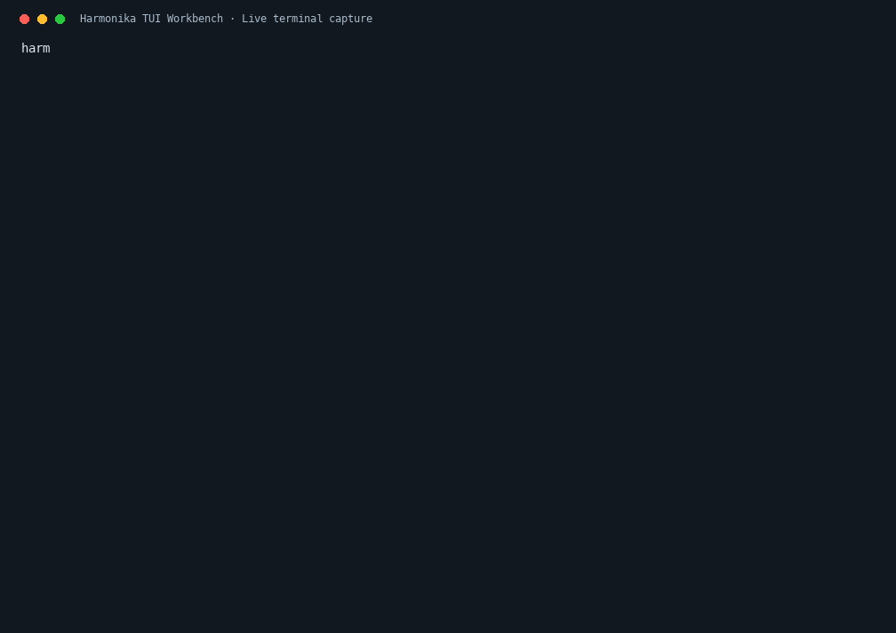

<div align="center">

# ⚡ HARMONIKA TUI

### Satu terminal. Satu ruang kerja. Harmonika Ai.

`Saya Harmonika AI, dirancang dan dikembangkan oleh Harmonika ID`

Coding, dokumen, analisis media, dan pengujian browser dalam alur kerja terminal yang terkontrol.



**Terminal baru v1.0.2** (engine opencode rebrand) — tanya apa saja · `ctrl+p` perintah · `shift+tab` agent · MCP terpasang

[](docs/assets/harmonika-demo.mp4)
[](docs/assets/harmonika-terminal.png)
[](https://harmonika.id)
[](docs/STATUS.md)


</div>

---

## 🚀 Instalasi Cepat

**Prasyarat:** Python **3.9+**, Node.js **18+**, Git, dan koneksi HTTPS.
Pada Windows gunakan Python **64-bit**.
Paket rilis membawa SDK MCP dan validator konfigurasi; **npm tidak diperlukan saat instalasi**.

| Sistem | Arsitektur binary tersedia |
|---|---|
| macOS | Apple Silicon (arm64), Intel (x64) |
| Linux | x64, arm64 |
| Windows 10/11 | x64 |

Matrix [pengujian installer](https://github.com/ffanu/harmonika-tui/actions/workflows/installer-platforms.yml)
menjalankan bootstrap, verifikasi signature/checksum, binary asli dan MCP pada lima target tersebut.
Platform lain ditolak dengan diagnostik; tabel ini bukan klaim mendukung seluruh OS/arsitektur.

**macOS / Linux:**

```sh
curl -fsSL https://chat.harmonika.id/assets/harmonika-terminal/install.sh | sh
```

Atau langsung dari source GitHub:

```sh
curl -fsSL https://raw.githubusercontent.com/ffanu/harmonika-tui/main/scripts/install.sh | sh
```

Pada terminal interaktif, installer meminta lisensi Harmonika, memverifikasinya,
memasang provider Harmonika, lalu membuka TUI agent. Pada Windows, key terlihat
saat diketik/ditempel dengan **Ctrl+V** atau **Shift+Insert**, lalu tekan Enter.
Pada macOS/Linux, prompt tetap tersembunyi. API key tidak dikirim melalui argumen proses. Instalasi memakai
server privat agar daftar provider tidak tertahan pada background server lama;
sesi yang sudah berjalan tidak dihentikan. Nama, logo dan tampilan TUI tetap.

**Windows (PowerShell):**

```powershell
irm https://chat.harmonika.id/assets/harmonika-terminal/install.ps1 | iex
```

Atau langsung dari source GitHub:

```powershell
irm https://raw.githubusercontent.com/ffanu/harmonika-tui/main/scripts/install.ps1 | iex
```

Rilis `2026.11.18.1` memperbaiki input lisensi Windows agar key terlihat saat
paste, serta pemilihan Python ketika kandidat awal gagal. Alur konsol Windows
dan instalasi lengkap diuji di CI;
[hasil pengujian](docs/WINDOWS-LICENSE-INSTALLER-AUDIT-20261118.json).

Rilis `2026.11.18.2` memperbaiki penemuan perintah setelah PowerShell dibuka ulang;
[bukti pengujian PATH Windows](docs/WINDOWS-COMMAND-PATH-AUDIT-20261118.json).

Tunggu pesan **Instalasi selesai** sebelum menutup jendela. Lisensi yang sudah
terverifikasi belum berarti penyiapan runtime telah selesai. Installer memakai
lokasi profil Python untuk launcher, menyimpan PATH pengguna dan menyiapkan
launcher kompatibilitas, bila tersedia folder pengguna yang sudah ada di PATH, agar tab
Windows Terminal dengan lingkungan lama tetap dapat menemukan `harmonika`.
Tidak mengubah PATH sistem, profil PowerShell atau file aplikasi lain.

**Manual dari source:**

```sh
git clone https://github.com/ffanu/harmonika-tui.git
cd harmonika-tui
python3 runtime/install.py
```

Pada Linux sebagai root, installer menautkan launcher ke `/usr/local/bin` bila folder itu ada di PATH dan nama perintah belum dipakai. Instalasi ulang juga memperbaiki launcher yang hilang. Untuk pengguna biasa/macOS, jika `~/.local/bin` belum ada di PATH shell saat ini:

```sh
export PATH="$HOME/.local/bin:$PATH"
```

Aktivasi lisensi memakai prompt privat, tanpa key pada argumen proses:

```sh
harmonika activate
harmonika doctor
harmonika network status
```

`curl | sh` menggunakan `/dev/tty` untuk prompt lisensi yang privat. Tanpa TTY
atau dengan `HARMONIKA_NONINTERACTIVE=1`, installer hanya memasang aplikasi;
aktivasi dilakukan saat membuka terminal atau dengan `harmonika activate`.
Agent tidak dimulai sebelum lisensi terverifikasi. Gunakan
`HARMONIKA_LAUNCH_AFTER_INSTALL=0` jika tidak ingin TUI dibuka otomatis.
Key diperoleh dari [@hmsapi_bot](https://t.me/hmsapi_bot); kebijakan 1 key = 1 perangkat tetap berlaku.

`mcp_preflight_failed` pada paket lama bisa disebabkan SDK tidak terpasang ketika npm tidak tersedia.
Installer baru memakai bundle bertanda tangan dan tetap menolak signature, checksum, atau protokol yang rusak.
Dependensi dokumen dan SSH dipasang otomatis dalam Python venv privat pada platform yang didukung.
Kegagalan dependensi fitur terlihat di `harmonika features`; pemasangan ulang melanjutkan setup.
`HARMONIKA_INSTALL_FEATURES=0` secara eksplisit memilih core saja. Pada paket legacy,
`HARMONIKA_INSTALL_SSH=1` mewajibkan setup SSH terpisah dan `HARMONIKA_INSTALL_SSH=0` melewatinya.
Pada Linux dengan `apt-get`, installer yang sudah berjalan sebagai root dapat memasang
library sistem Chromium jika probe nyata membuktikannya belum tersedia. Tidak memakai
`sudo`, upgrade paket yang sudah ada, restart layanan, atau perubahan firewall.
Gunakan `HARMONIKA_INSTALL_SYSTEM_DEPS=0` untuk melewati langkah sistem tersebut.
Instalasi Windows memakai folder pengguna dan tidak mengubah Defender atau System32.

---

## Profil agent portabel

Installer memasang profil agent yang sama untuk macOS arm64/x64, Linux
arm64/x64, dan Windows x64. Binary native, ASCII, brand, dan riwayat sesi
pengguna dipertahankan. Platform/arsitektur di luar tabel dukungan ditolak
secara jelas; tidak ada klaim semua OS dapat menjalankan kontrol OS yang sama.

| Komponen | Pemasangan dan batas |
|---|---|
| Skill panduan | 36 folder dipasang dan didaftarkan ke `skills` native |
| Agent v3.2 | Checkpoint, rekonsiliasi job dan verifikasi hasil; `harmonika agent-v32 --help` |
| Kontrol native | F8 pekerjaan, F9 memori, F10 engine, Shift+F10 koneksi |
| Context guard | Batas transport dan pasangan tool/result; bukan klaim model 1M |
| MCP Mac yang portabel | Operasi kode/tes/OS, visualisasi, browser, network, memori dan terjemahan |
| Dokumen/SSH/browser | Dependensi otomatis di runtime privat per pengguna, tanpa pip/npm global |
| Media/OCR/video | Konektor gateway Harmonika; keberhasilan tetap bergantung pada layanan/model dan lisensi |

Tidak diperlukan npm untuk instalasi. Runtime browser memakai dependensi
Playwright terkunci dan Node privat bila Node sistem terlalu lama; browser
Chromium diunduh dari distribusi resminya. Runtime dokumen/SSH memakai venv
terpisah. Internet, ruang disk dan library OS yang dibutuhkan tetap diperlukan.
Jika layanan eksternal atau library sistem belum siap, hasilnya **degraded**
dengan diagnostik; tersedianya nama tool tidak dianggap bukti berhasil.

Pembaruan instruksi internal selama agent bekerja mempertahankan asal pesan
sistemnya. Hasil tool tetap terikat pada tugas pengguna yang sama; tag yang
diketik pengguna tidak dapat berubah menjadi instruksi sistem. Ini memperbaiki
kasus `invalid_tool_response` sesudah perintah sebenarnya sudah berhasil.

Cek hasil pemasangan:

```sh
harmonika doctor
harmonika features
harmonika agent-v32 --help
```

`HARMONIKA_INSTALL_FEATURES=0` adalah pilihan eksplisit untuk instalasi core
saja; default memasang dependensi fitur. Installer ulang dapat melanjutkan
penyiapan yang belum selesai. SSH dan akun browser memakai konfigurasi masing-
masing perangkat. Akses server, cookie, API key, memori pribadi dan riwayat chat
MacBook pengembang **tidak masuk paket GitHub**. Migrasi konektor lama hanya
berlaku lokal pada perangkat pemilik dan tetap disimpan privat.

Kontrol Chrome macOS memakai mekanisme macOS; Linux/Windows memakai runtime
browser/CDP atau target remote yang dikonfigurasi. Perintah administrasi POSIX
lokal dan Xvfb tidak dipaksakan berjalan di Windows. Sandbox v3.2 berbasis
`sandbox-exec` khusus macOS; platform lain menolak flag tersebut secara eksplisit.

Daftar skill dan bukti pengujian pemasangan tersedia di
[audit profil agent lintas OS](docs/INSTALLER-AGENT-PARITY-AUDIT-20261117.json).

---

## 🖥️ Terminal Baru (engine 1.0.2)

Ruang kerja terminal generasi baru Harmonika — tampilan di GIF atas:

| Permukaan | Tombol | Fungsi |
|---|---|---|
| Input utama | langsung ketik | *"Ask anything…"* — tanya apa saja, terhubung engine + MCP |
| Command palette | `ctrl+p` | cari perintah: ganti model (`ctrl+x m`), integrasi, pengaturan |
| Agent switcher | `shift+tab` | pindah antar agent/persona |
| Menu | `F10` | navigasi utama |

Berjalan lokal lewat `harmonika --standalone` (server privat) atau terhubung ke background service — sesi, MCP, dan integrasi tetap tersambung.

### Engine: rebrand opencode (MIT)

Binary TUI yang dipasang installer adalah **engine Harmonika 1.0.1** — build ulang dari
[opencode](https://github.com/anomalyco/opencode) (lisensi MIT) pada base `db1d7b9120`
(upstream terbaru), dipatch lewat `engine/patches/0001..0006` dan dapat direproduksi:

```bash
engine/scripts/verify-patches.sh                  # tree patch == harmonika/main
engine/scripts/smoke-engine.sh engine/bin/harmonika-darwin-arm64
```

Yang berubah hanya lapisan brand: wordmark **HARMONIKA**, provider/model Harmonika
(`harmonika-ai`, `-codex` → *Harmonika Ai Pro*, `-google`), direktori config `harmonika-terminal`,
dan seluruh jalur update/distribusi upstream dimatikan (hanya manifest
`chat.harmonika.id/.../engine/update.json`). Layout TUI — prompt bar, `ctrl+p`, `shift+tab`,
`F10` — identik dengan upstream opencode. TUI dibuka **mode penuh tanpa wrapper**.
Atribusi & lisensi: [NOTICE.md](NOTICE.md) · [UPSTREAM-LICENSE.md](UPSTREAM-LICENSE.md).

### Workbench TUI (opsional)

Paket saat ini **tidak menyertakan** `tools/workbench.py`, sehingga `harmonika` membuka TUI
engine secara penuh. Bila workbench dipasang (tersedia di source), alur kerja panjang bisa
dipakai: `F2` metrik · `F3` kejadian teredaksi · `F4` file/kode · `F5` diff · `F7` shell
proyek · `F8` durasi respons · `Ctrl+P` chat native · LSP otomatis saat file dibaca.
`HARMONIKA_WORKBENCH=0` (atau `--no-workbench`) memaksa mode penuh.
[Shortcut & pengujian →](docs/TUI-WORKBENCH.md)

---

## 🧰 Ruang kerja yang menyatu

| | Kemampuan | Tersedia |
|---|---|---|
| ⌨️ | **Coding & terminal** | baca/edit file, proyek, bash dengan persetujuan, diagnostik LSP (5 LSP) |
| 🧩 | **Skill modular** | 23 skill resmi — lihat [matriks kesiapan](docs/SKILL-READINESS.md) |
| 🌐 | **Browser QA** | screenshot desktop 1440×900 / mobile 390×844, deteksi overflow, error console |
| 📄 | **Dokumen** | baca/buat PDF, DOCX, XLSX, PPTX lokal; merge/rotasi/watermark PDF |
| 🖼️ | **Media** | analisis gambar & frame video, transkripsi audio lokal, gambar via layanan RTX |
| 🔑 | **Kontrol key** | validasi ke server, entitlement, penyimpanan privat |
| 🛡️ | **Update terkendali** | signature Ed25519, checksum SHA-256, preflight, rollback — tanpa auto-update |

**Skill resmi** (25): `harmonika-ui` · `visual-design` (RTX + OCR) · `debug` · `debug-scanner` · `browser-qa` · `shared-core` · `skill-index` · `mobile-builder` · `web-builder` · `legal` · `coding` (38 operasi) · `engineering` · `seo` · `documents` · `erp` · `ssh` · `git` · `release` · `tui-dev` · `async-concurrency` · `ai-integration` · `state-persistence` · `terminal-qa` · `delegate` · `cf`

> 📖 Detail tiap skill: [docs/SHARED-SKILLS.md](docs/SHARED-SKILLS.md) · [docs/MASTER-SKILLS.md](docs/MASTER-SKILLS.md)

---

## 🧠 Engine

| Engine | Skala | Dokumentasi |
|---|---|---|
| **Unified engine backend** | 70 ID — 57 callable, 12 mekanisme internal, 1 transport WSS | [Kontrak](docs/UNIFIED-ENGINE.md) |
| **Shared Skill Core** (`/v1/core`) | 99 ID — 12 data/memory/workflow, 19 adaptor workspace, 6 dokumen lokal | [Kontrak](docs/CORE-FOUNDATION.md) |
| **Kapasitas konteks** | **872.000 token** (compact 780k) · probe terisolasi terverifikasi 807.776 · uji domain 500K lulus | [Bukti](docs/CONTEXT-CAPACITY-20261113.json) |
| **Telekomunikasi** | 276 ID / 25 engine — inventory, provisioning, billing, SLA | [Kontrak](docs/TELCO-ENGINE.md) |
| **Mobile builder** | 214 ID — Android/iOS spec & source kit | [Kontrak](docs/MOBILE-BUILDER.md) |
| **Web builder** | 161 ID — spec → scaffold 10 framework → QA | [Kontrak](docs/WEB-BUILDER.md) |
| **ERP multi-industri** | 363 ID — 25 profil industri, Next/Nest/PostgreSQL | [Kontrak](backend/erp_engine/README.md) |
| **Legal assistant** | 99 handler — domain privat, bukan advokat | [Kontrak](docs/LEGAL-ENGINE.md) |
| **Indeks pusat** | master 1.200 ID; katalog gabungan 1.795 | [Laporan](docs/MASTER-SKILLS-REPORT.json) |

Kontrak inti: `AIRequest → AIIntegration → AIAdapter` memisahkan TUI dari model guru/lokal/LLM mandiri — [interface](docs/AI-INTEGRATION.md). Registry modul dipindai otomatis saat boot + tiap 5 detik tanpa restart gateway — [kontrak](docs/ENGINE-DISCOVERY.md).

### Rilis & pembaruan terbaru
- **Audit pembaruan agent dan MCP (17 Nov 2026)**: perbaikan bukti selesai, replay tool, pencarian file sensitif, argumen MCP, transport Unicode/deadline, routing vision RTX, race proxy dan isolasi knowledge per API key. Rincian pengujian, aktivasi dan batas kemampuan: [laporan audit](docs/AGENT-UPDATE-AUDIT-20261117.json).
- **Ujian inisiatif binary Harmonika terpasang**: 3/3 misi lokal sintetis lulus dengan satu perintah tanpa arahan susulan. Pemulihan lima cacat lintas modul lolos 8 tes layanan dan 4 tes independen; agen membuat 3 tes tambahan sendiri. Audit membedakan pembayaran pending, event duplikat dan nominal kurang. Ini hasil satu sampel per misi, bukan peringkat universal. [Bukti & batas pengujian](docs/HARD-AGENT-EXAM-20261115.json).
- **Perbaikan `invalid_tool_response` pada laporan diagnostik**: 3 pemicu native berhasil direproduksi dan diperbaiki; 5/5 uji ulang/regresi terminal dan 12/12 misi model lulus. Tes gagal, error sintaks dan nol tes dapat dilaporkan tanpa mengarang keberhasilan atau mengubah file. [Bukti sebelum/sesudah](docs/INVALID-TOOL-RESPONSE-HUNT-20261115.json).
- **Inisiatif perintah dan laporan berbukti**: 6/6 ujian Cline dengan stdin bersih, 16 pemeriksaan tambahan independen dan 12/12 regresi model lulus. Perintah singkat dilanjutkan menjadi tindakan; audit read-only dapat melaporkan tes gagal, dan data bertentangan tetap diberi status belum terverifikasi. [Hasil, bug yang diperbaiki & batas pengujian](docs/INITIATIVE-COMMAND-EXAM-20261115.json).
- **Level18 — pemulihan hasil parsial dan status tidak pasti**: 12/12 misi model nyata dan 3/3 regresi Cline lulus; receipt terpotong tidak menjadi bukti selesai, job direkonsiliasi tanpa submit ulang, dan write penuh dapat diperiksa lewat readback hash yang cocok. [Hasil, perbaikan & batas pengujian](docs/LEVEL18-AGENT-EXAM-20261115.json).
- **Level17 — kecocokan scope verifikasi**: 12/12 misi model nyata dan 3/3 regresi Cline lulus; proyek/cwd, revisi, attempt dan identitas job diperiksa sebelum hasil dipakai untuk menyatakan selesai. [Hasil, perbaikan & batas pengujian](docs/LEVEL17-AGENT-EXAM-20261115.json).
- **Level16 — pemulihan batch per perintah**: 12/12 misi model nyata dan 3/3 regresi Cline lulus; hasil parsial, status anak, bukti tes dan pengulangan mutasi dikontrol pada planner aktif. [Hasil, provenance & batas pengujian](docs/LEVEL16-AGENT-EXAM-20261115.json).
- **Level15 — inisiatif dan pemulihan agent**: 18/18 misi backend dan 3/3 ujian Cline asli lulus; rekonsiliasi job, bukti tes terbaru, pembatasan tool dan korelasi respons Cline aktif pada planner. [Hasil, versi aktif & batas pengujian](docs/LEVEL15-AGENT-EXAM-20261115.json).
- **Level14 — bukti workspace backend**: kontrak actor/proyek, tes independen, readback, checkpoint dan replay tanpa mutasi ganda. [Hasil & batas pengujian](docs/LEVEL14-AGENT-EXAM-20261115.json) · [API verifikasi](docs/LEVEL14-EVIDENCE.md). Tools lokal TUI tetap `client_reported`.
- **Kapasitas konteks 872k** — profil Linux & Mac primary/Pro diselaraskan; [ujian 1M](docs/CONTEXT-1M-EXAM-20261113.json) & [aktivasi](docs/CONTEXT-CAPACITY-20261113.json)
- **OCR bersama (13 Nov 2026)** — default Qwen3-VL 8B via gateway RTX, fallback PaddleOCR PP-OCRv5; [backend](backend/ocr_rtx/README.md)
- **Visual & mockup QA** — ujian mockup nyata + chunk tumpang tindih; [bukti](docs/MOCKUP-EXAM-20261113.json)
- **TUI control runtime** — retry, model, activation + rangkaian test
- **Phase 2 Power Coding** — 20 skill scaffold/format/test/debugger; [status](docs/ENGINEERING-PHASE2-STATUS.json)

---

## 🛡️ Pertahanan & keamanan

- **`trust_guard`** (offline): skor `fraud_risk` dari telemetri, audit CAPTCHA, audit privasi/sidik jari, rencana anti-bot berlapis — tanpa akses jaringan, tanpa PII
- **`qa_matrix`**: audit responsif + aksesibilitas 5 profil perangkat (en-US & id-ID) — tap target, kontras, alt, overflow → report.json + screenshot
- **SSH terdaftar**: konektor Paramiko, host key terverifikasi, approval sekali pakai, audit mekanik tanpa isi — [spec](docs/SSH-CONNECTOR-SPEC.txt)
- **Backend SSH privat**: REST async + owner token + rate limit — [setup](backend/remote_access/README.md)
- **Sandbox & izin**: bash dengan persetujuan; workspace coding terisolasi; secret connector tidak mengembalikan nilai

Batas lengkap: [SAFETY.md](SAFETY.md) · [SECURITY.md](SECURITY.md)

---

## 🎬 Demo yang nyata

GIF & video direkam dari aplikasi Harmonika yang **benar-benar berjalan** pada PTY terisolasi — tanpa mockup percakapan, token contoh yang menyerupai key nyata, atau data pelanggan. Script perekam tersedia: [record-workbench.py](docs/assets/record-workbench.py) (terminal baru) · [record-demo.py](docs/assets/record-demo.py).

---

## 🔑 Key & layanan

**Domain:** `https://harmonika.id` · **Identitas:** Harmonika Ai
**Kebijakan lisensi:** 1 API Key = 1 Perangkat (Single Device), diterbitkan & dapat dicabut server
**Permintaan key:** 🤖 Telegram [@hmsapi_bot](https://t.me/hmsapi_bot) · 📱 WhatsApp `085771378237`

```sh
python3 runtime/license.py check      # cek status key
python3 runtime/license.py activate   # aktivasi (prompt tersembunyi)
```

*Unlimited mengacu kuota request key; concurrency, durasi proses, dan ketersediaan worker tetap berlaku. Source tidak memberi akses ke akun, SSH pribadi, browser pribadi, CS, ERP, atau database pelanggan.*

---

## 🔄 Update dari Harmonika

```sh
harmonika update --check
harmonika update --apply /path/paket-rilis.zip
harmonika rollback
```

Pembaruan atas perintah pengguna; paket diverifikasi sebelum aktif; versi lama disimpan untuk pemulihan. Key, cookie, history, dan signing key privat tidak pernah ikut paket publik. [Katalog layanan](https://chat.harmonika.id/assets/harmonika-terminal/)

---

## 🧪 Verifikasi & batas kemampuan

Teruji pada **Mac Apple Silicon**: tool MCP, pembatasan path, branding, dokumen, lisensi, bootstrap, signature, rollback, HOME terisolasi.

- Browser QA: desktop **1440×900**, mobile **390×844**
- PDF: baca/buat/merge/rotasi/watermark; ekstraksi **20 hlm / 30.000 karakter / 10 MiB**; scan/OCR PDF belum didukung
- Audio: **120 detik pertama** · Video: **6 frame sampel**
- Dokumen Office: konten dasar (bukan pelestarian layout kompleks/makro)
- Baseline core: instalasi baru, wrapper `doctor`, discovery MCP, dan penolakan paket rusak lulus pada lima platform ([CI baseline](https://github.com/ffanu/harmonika-tui/actions/runs/44038269383)). Profil agent lengkap menambahkan pengujian dependensi, pemuatan plugin native, dan ACL Windows dalam [matrix CI terbaru](https://github.com/ffanu/harmonika-tui/actions/workflows/installer-platforms.yml); hasil baseline bukan bukti fitur baru telah lulus di semua platform.

[Status terperinci & penghalang publik →](docs/STATUS.md)

---

## 📁 Struktur repository

```
runtime/    Launcher, validasi key, pemeriksaan rilis, tool MCP
skills/     23 skill resmi beserta helper
backend/    Engine domain (core, telco, ERP, RTX, OCR, SSH, video)
docs/       Status, demo GIF/video, kontrak & laporan
tests/      Pengujian terisolasi
```

Credential, binary pribadi, database, cookie, sesi pengguna, dan audit privat **tidak** dimasukkan ke repository.

---

## 📄 Lisensi

Komponen pihak ketiga mengikuti hak cipta dan ketentuan masing-masing — lihat [NOTICE.md](NOTICE.md) · [UPSTREAM-LICENSE.md](UPSTREAM-LICENSE.md). Perubahan merek tidak menghapus kewajiban tersebut.

---

<div align="center">

**Harmonika Ai — ruang kerja Anda, tetap dalam kendali Anda.**

[harmonika.id](https://harmonika.id)

</div>
