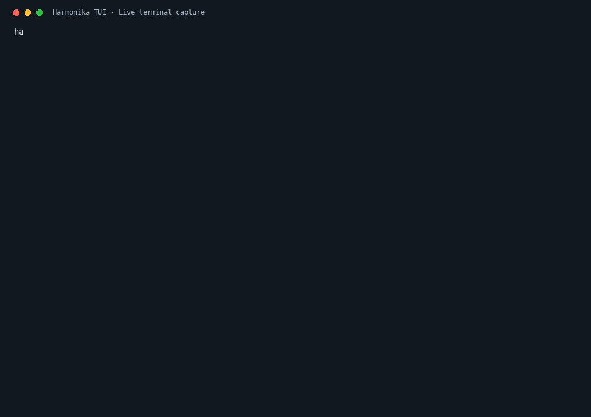

<div align="center">

# HARMONIKA TUI

### Satu terminal. Satu ruang kerja. Harmonika Ai.

Coding, dokumen, analisis media, dan pengujian browser dalam alur kerja terminal yang terkontrol.

**6 skill resmi** · **8 tool MCP** · **5 LSP** · **Update manual terverifikasi**

[Website](https://hai.harmonika.id) · [Panel & API](https://chat.harmonika.id) · [Status rilis](docs/STATUS.md) · [Dokumentasi](#mulai)



[▶ Tonton video MP4](docs/assets/harmonika-demo.mp4) · [Lihat screenshot](docs/assets/harmonika-terminal.png)

</div>

> **Source preview** — aplikasi lokal sudah diuji. Installer publik, distribusi binary, dan entitlement key terminal masih disiapkan. Jangan membagikan credential instalasi pemilik. [Lihat kesiapan publik →](docs/STATUS.md)

## Ruang kerja yang menyatu

| | Kemampuan | Yang tersedia |
|---|---|---|
| ⌨️ | **Coding & terminal** | Baca/edit file, membuat folder proyek, bash dengan persetujuan pengguna, dan diagnostik LSP. |
| 🧩 | **Skill terarah** | Alur UI, debug, browser QA, dokumen, Git, dan rilis. |
| 🌐 | **Browser QA** | Screenshot desktop/mobile, pemeriksaan overflow, serta pencatatan error halaman. |
| 📄 | **Dokumen** | Membaca dan membuat DOCX, XLSX, PPTX; ekstraksi teks PDF melalui MCP. |
| 🖼️ | **Media** | Analisis gambar, frame video, transkripsi audio lokal, dan permintaan gambar melalui layanan Harmonika Ai. |
| 🔑 | **Kontrol key** | Validasi key ke server, pemeriksaan entitlement, dan penyimpanan key privat. |
| 🛡️ | **Pembaruan terkendali** | Signature Ed25519, checksum SHA-256, preflight, dan rollback. Tidak ada auto-update. |

### Skill resmi

| Skill | Fokus |
|---|---|
| `harmonika-ui` | Implementasi UI responsif, aksesibilitas, dan kesesuaian referensi. |
| `harmonika-debug` | Reproduksi bug, diagnosis berbasis bukti, serta pengujian regresi. |
| `harmonika-browser-qa` | Bukti browser nyata pada viewport desktop dan mobile. |
| `harmonika-documents` | Baca/buat dokumen melalui runtime lokal yang terdeteksi. |
| `harmonika-git` | Review perubahan dan alur Git tanpa tindakan destruktif otomatis. |
| `harmonika-release` | Pemeriksaan rilis, paket, verifikasi, dan rencana pemulihan. |

## Demo yang nyata

GIF dan video di atas direkam dari aplikasi Harmonika yang berjalan pada **PTY terisolasi**. Demo menampilkan pemanggilan terminal, versi, pemeriksaan kesehatan, banner HARMONIKA, skill, dan koneksi MCP. Tidak memakai mockup percakapan, token contoh yang menyerupai key nyata, atau data pelanggan.

Script perekam tersedia di [`docs/assets/record-demo.py`](docs/assets/record-demo.py). Perekaman memerlukan aplikasi terpasang, Pillow, pyte, serta font monospace yang sesuai platform. Video dapat dibuat dari GIF dengan encoder lokal. Demo bukan bukti bahwa fresh installer publik sudah tersedia.

## Mulai

Pada instalasi Harmonika yang sudah disiapkan:

```sh
harmonika
harmonika doctor
harmonika skill documents capabilities
harmonika skill browser --url http://localhost:3000 --out /path/proyek/qa
```

Dari Home, minta AI membuat folder melalui `create_directory` di Downloads atau Projects. Operasi file berikutnya menggunakan folder proyek tersebut; direktori privat dan credential tetap dilindungi.

### Untuk pengembang

```sh
git clone git@github.com:ffanu/harmonika-tui.git
cd harmonika-tui
python3 runtime/check-public-source.py
python3 runtime/public-preflight.py
```

`public-preflight.py` sengaja mengembalikan `public_ready=false` selama penghalang distribusi belum diselesaikan. Repository ini belum menyediakan perintah instalasi satu baris untuk perangkat baru.

## Key & layanan

**Base URL:** `https://chat.harmonika.id/v1`<br>
**Identitas layanan:** Harmonika Ai

Setiap pengguna harus memiliki key sendiri yang diterbitkan serta dapat dicabut oleh server. Hak coding dan unlimited berasal dari entitlement server; mengubah konfigurasi client tidak memberikan hak tambahan.

```sh
python3 runtime/license.py check
python3 runtime/license.py activate
```

Aktivasi meminta key melalui prompt tersembunyi, bukan argumen shell. Key disimpan dengan permission `0600`. Aktivasi gagal tidak mengganti key sebelumnya. Token standar Telegram saat ini belum otomatis memberi coding/unlimited. Jalur penerbitan key terminal masih menjadi bagian pekerjaan backend publik.

Unlimited mengacu pada kuota request key, sementara concurrency, waktu proses, dan ketersediaan worker tetap berlaku. Source tidak memberikan akses ke akun, SSH, browser pribadi, CS, ERP, atau database pelanggan.

## Update dari Harmonika

```sh
harmonika update --check
harmonika update --apply /path/paket-rilis.zip
harmonika rollback
```

Pembaruan dilakukan atas perintah pengguna. Paket diverifikasi sebelum diaktifkan; versi sebelumnya disimpan untuk pemulihan. Key, cookie, history, dan signing key privat tidak disertakan dalam paket publik.

[Katalog layanan & dokumentasi Harmonika](https://chat.harmonika.id/assets/harmonika-terminal/)

## Verifikasi & batas kemampuan

Source telah diuji pada **Mac Apple Silicon**. Pengujian meliputi tool MCP, pembatasan path, branding, dokumen, lisensi key, bootstrap, signature, rollback, serta HOME terisolasi dengan dependency yang disediakan.

- Browser QA diuji pada desktop **1440 × 900** dan mobile **390 × 844**.
- Dokumen Office mendukung konten dasar, bukan jaminan pelestarian layout kompleks atau makro.
- PDF: teks maksimal **20 halaman**; PDF scan/OCR belum didukung.
- Audio: maksimal **120 detik pertama**.
- Video: **6 frame sampel**; suara tidak ikut dianalisis.
- Media menggunakan path file melalui MCP; bukan upload native UI.
- Kemampuan layanan tetap mengikuti entitlement key dan kesiapan worker.
- Windows/Linux dan instalasi lengkap pada perangkat baru belum diverifikasi.

[Status terperinci dan penghalang publik →](docs/STATUS.md)

## Struktur repository

```text
runtime/      Launcher, validasi key, pemeriksaan rilis, dan tool MCP
skills/       Enam skill resmi beserta helper
tests/       Pengujian terisolasi
docs/        Status, demo GIF/video, dan screenshot
```

Credential, binary pribadi, database, cookie, sesi pengguna, audit privat, dan direktori dependency tidak dimasukkan ke repository.

## Lisensi & pemberitahuan

Komponen pihak ketiga tetap mengikuti pemberitahuan hak cipta dan ketentuan lisensinya. Lihat [NOTICE.md](NOTICE.md) dan [UPSTREAM-LICENSE.md](UPSTREAM-LICENSE.md). Perubahan merek tidak menghapus kewajiban tersebut.

---

<div align="center">

**Harmonika Ai — ruang kerja Anda, tetap dalam kendali Anda.**

[hai.harmonika.id](https://hai.harmonika.id) · [chat.harmonika.id](https://chat.harmonika.id)

</div>
