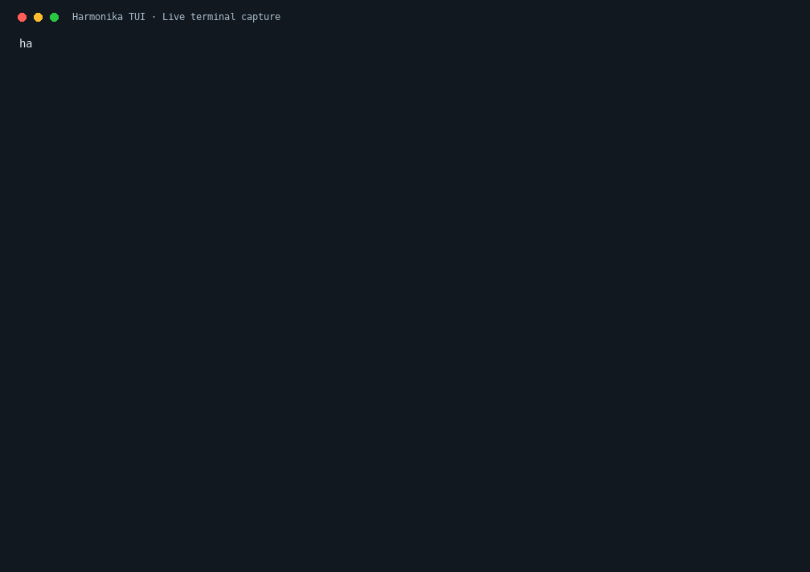

<div align="center">

# HARMONIKA TUI

### Satu terminal. Satu ruang kerja. Harmonika Ai.

Coding, dokumen, analisis media, dan pengujian browser dalam alur kerja terminal yang terkontrol.

**Skill modular** · **OCR & desain RTX** · **5 LSP** · **Update manual terverifikasi**

[Website](https://harmonika.id) · [Status rilis](docs/STATUS.md) · [Dokumentasi](#mulai)



[▶ Tonton video MP4](docs/assets/harmonika-demo.mp4) · [Lihat screenshot](docs/assets/harmonika-terminal.png)

</div>

> **Source preview** — aplikasi lokal sudah diuji. Installer publik, distribusi binary, dan entitlement key terminal masih disiapkan. Jangan membagikan credential instalasi pemilik. [Lihat kesiapan publik →](docs/STATUS.md)

## Ruang kerja yang menyatu

Kontrol native baru: **F8 pekerjaan**, **F9 memori proyek**, **F10 status engine**
dan **Shift+F10 koneksi**. F8 menampilkan tahap pekerjaan; hook server membatasi
retry error sementara dan menghentikan error akses/schema/secret. Panel mempertahankan ASCII, tema, F2 dan session store.
Memori disimpan hanya setelah persetujuan; reconnect tidak mengirim ulang tugas.
Pemasangan manual memakai paket Ed25519, verifikasi hash dan backup rollback;
binary native tidak diganti. [Penggunaan dan batas pengujian](docs/TUI-CONTROL.md).

| | Kemampuan | Yang tersedia |
|---|---|---|
| ⌨️ | **Coding & terminal** | Baca/edit file, membuat folder proyek, bash dengan persetujuan pengguna, dan diagnostik LSP. |
| 🧩 | **Skill terarah** | Alur UI, debug, browser QA, dokumen, Git, dan rilis. |
| 🌐 | **Browser QA** | Screenshot desktop/mobile, pemeriksaan overflow, serta pencatatan error halaman. |
| 📄 | **Dokumen** | Baca/buat PDF, DOCX, XLSX, PPTX secara lokal; pengolahan halaman dan watermark PDF. |
| 🖼️ | **Media** | Analisis gambar, frame video, transkripsi audio lokal, dan permintaan gambar melalui layanan Harmonika Ai. |
| 🔑 | **Kontrol key** | Validasi key ke server, pemeriksaan entitlement, dan penyimpanan key privat. |
| 🛡️ | **Pembaruan terkendali** | Signature Ed25519, checksum SHA-256, preflight, dan rollback. Tidak ada auto-update. |

### Skill resmi

| Skill | Fokus |
|---|---|
| `harmonika-ui` | Implementasi UI responsif, aksesibilitas, dan kesesuaian referensi. |
| `harmonika-visual-design` | Foto RTX, mockup PNG desktop/mobile, tipografi presisi, dan pemeriksaan visual serta OCR. |
| `harmonika-ocr` | Ekstraksi dokumen/tabel/PDF, cakupan halaman, perhitungan dan ekspor JSON/CSV dengan provenance serta ketidakpastian. |
| `harmonika-debug` | Reproduksi bug, diagnosis berbasis bukti, serta pengujian regresi. |
| `harmonika-debug-scanner` | Scanner backend dengan bukti teredaksi, probe target terdaftar, dan laporan PDF; readiness tiap fungsi dinyatakan jelas. |
| `harmonika-browser-qa` | Bukti browser nyata pada viewport desktop dan mobile. |
| `harmonika-shared-core` | Data terbatas, memory terenkripsi per token, workflow DAG dan adaptor workspace melalui API internal. |
| `harmonika-project-context` | Catatan teknis proyek yang disetujui eksplisit, kompresi konteks tool dan penggunaan referensi secret privat. |
| `harmonika-skill-index` | Discovery capability, analisis defensif, dan pemeriksaan HTML browser terisolasi. |
| `harmonika-mobile-builder` | Analisis spec dan source kit Android/iOS; build/sign/store mengikuti readiness worker terpisah. |
| `harmonika-web-builder` | Spesifikasi → arsitektur → source privat → QA sandbox → deployment target terdaftar. |
| `harmonika-legal` | Perkara/bukti privat, edukasi berbasis sumber resmi, dan gateway legal terpisah; bukan layanan advokat. |
| `harmonika-coding` | 38 operasi backend dalam workspace privat: baca/edit/run/test/Git dengan approval. |
| `harmonika-engineering` | Review kode, diagnosis berbasis bukti, rencana pengujian dan dokumentasi dari input yang dikirim. |
| `harmonika-seo` | Audit halaman/teknis/konten/schema/sitemap, visual, drift, strategi dan adapter data Google. |
| `harmonika-documents` | Baca/buat dokumen melalui runtime lokal yang terdeteksi. |
| `harmonika-erp` | Planner 25 industri dan source starter ERP; readiness domain ditampilkan eksplisit. |
| `harmonika-ssh` | Koneksi key-auth dan SFTP ke target terdaftar melalui MCP khusus; policy bash tetap terpisah. |
| `harmonika-git` | Review perubahan dan alur Git tanpa tindakan destruktif otomatis. |
| `harmonika-release` | Pemeriksaan rilis, paket, verifikasi, dan rencana pemulihan. |
| `harmonika-tui-dev` | Layout terminal, resize, fokus keyboard, dan clipping ANSI. |
| `harmonika-async-concurrency` | Antrean terbatas, streaming nonblocking, timeout dan pembatalan. |
| `harmonika-ai-integration` | Parser SSE/UTF-8, penyusunan konteks dan riwayat tool yang utuh. |
| `harmonika-state-persistence` | Integritas sesi native, checkpoint dan cache metadata privat per proyek. |
| `harmonika-terminal-qa` | Uji reducer, keyboard, resize dan PTY terisolasi. |

Helper baru memakai Python stdlib dan fixture sintetis; hasil self-test membuktikan helper, bukan perubahan pada event loop binary aplikasi. Skill memberi panduan dan implementasi referensi yang dapat dipakai saat mengerjakan source TUI.

Generasi burung alami pada adaptor RTX high kini menahan hasil sebelum pemeriksaan jumlah kepala/tubuh selesai. Hasil cacat mendapat paling banyak satu koreksi; status tidak pasti tidak mengirim job duplikat. [Cakupan, aktivasi dan batas pemeriksaan](backend/visual_quality/README.md#bird-anatomy-delivery-gate).

Ujian mockup ERP memperketat QA enam ukuran layar, kecocokan area penting dengan bingkai PNG, kontras, teks kecil dan label grafik terbelah. Hasil tetap disertai source yang dapat diedit serta metode render aktual. [Bukti ujian ERP](docs/ERP-MOCKUP-EXAM-20261113.json) · [Alur penerimaan mockup](backend/visual_quality/MOCKUP-QUALITY.md).

[Filosofi arsitektur core mandiri](docs/ARCHITECTURE-PHILOSOPHY.md): mentor eksternal, interface internal, dan target worker media Windows RTX.

## Engine modular

Pemulihan Zimbra pada runtime operator menyediakan `zimbra_health`,
`zimbra_component`, `zimbra_tls_audit`, `zimbra_ssl_plan`, `zimbra_mailjet_plan`
dan `zimbra_qa`. Dua puluh empat Q&A menjadi panduan
diagnosis otomatis; izin proses tetap mengikuti target dan tindakan pengguna.
Pengetahuan pure yang sama tersedia melalui skill backend `zimbra.qa`.
[Alur, batas dan pengujian](backend/zimbra/README.md).

Kontrak `AIRequest → AIIntegration → AIAdapter` memisahkan TUI dari model guru, lokal, atau LLM mandiri. Payload, event, dan identitas UI tetap sama. [Interface dan contoh pemakaian](docs/AI-INTEGRATION.md). [Restart aman dan verifikasi](docs/GATEWAY-MAINTENANCE.md).

## Unified engine backend

Backend `harmonika.id` menyediakan sesi privat, job, routing otomatis,
Stop dan replay SSE. Tepat70 ID blueprint:57 callable,12 mekanisme internal,1 transport WSS;
seluruh70 ID konkret terhubung. GraphQL, event bus, knowledge API dan secret connector
tersedia sesuai scope. Perencanaan web/mobile memakai engine yang sudah ada; bukan klaim build
atau deploy. [Kontrak backend](docs/UNIFIED-ENGINE.md) · [Laporan](docs/UNIFIED-ENGINE-COMPLETION-REPORT.json).

## Registry otomatis

Modul operator baru dipindai dan diverifikasi saat boot serta setiap 5 detik,
lalu langsung tersedia di `/v1/skills` tanpa restart gateway. Kontrak rusak,
checksum berubah dan ID bentrok ditolak dengan audit SQLite terpisah.
`harmonika state status` menampilkan status engine; binary TUI tetap sama.
[Kontrak dan batas](docs/ENGINE-DISCOVERY.md) · [Hasil uji](docs/ENGINE-DISCOVERY-REPORT.json).

## Shared Skill Core

Fondasi `/v1/core` menyatukan **99 ID** dengan status yang eksplisit: **12 operasi
data/memory/workflow**, **19 adaptor workspace**, **2 adaptor chat**, **6 dokumen
lokal**, dan **60 belum tersedia**. Adaptor workspace mempertahankan permission,
approval dan job engine coding. Memory terenkripsi, TTL dan idempotency diperiksa
per token; workflow hanya memakai operasi pure yang terdaftar.
Gunakan `harmonika core capabilities`, `harmonika core inspect ID`, atau
`harmonika core invoke ID` dengan JSON stdin. REST ini belum menyediakan stream
atau native MCP tambahan. [Kontrak dan contoh](docs/CORE-FOUNDATION.md).

Registry bersama memuat 9 operasi dokumen, 14 operasi SEO, 4 workflow engineering, dan 38 operasi coding workspace, ditambah 276 deskriptor telekomunikasi dan 99 deskriptor legal dan 161 deskriptor web builder (601 total; status aktif mengikuti capability, bukan jumlah katalog).
Coding workspace memakai runtime terisolasi tersendiri; perintah lokal tidak diam-diam menjalankannya di host. [Kontrak coding MVP](docs/CODING-MVP.md).
Identity/proyek, permission, idempotency, Stop dan event job diperiksa sebelum
worker lokal dijalankan. `harmonika skills list` menampilkan readiness aktual;
`harmonika skills execute` menerima JSON stdin. API publik telah menghubungkan subset SEO read-only serta workflow engineering dari pesan pengguna. Operasi dokumen dan artifact lokal tetap melalui executor lokal; tidak semua operasi tersedia lewat REST/MCP. [Kontrak dan batas fase](docs/SHARED-SKILLS.md).

## Harmonika SEO

Audit berbasis bukti untuk halaman, teknis, konten, JSON-LD, sitemap, local SEO dan
GEO. Tersedia cluster keyword, snapshot visual desktop/mobile, baseline drift,
verifikasi tautan sumber, serta adapter PSI dan Search Console/GA4. Readiness/data
provider tetap diperiksa; OAuth Google diperlukan untuk data akun, dan screenshot
JS-disabled bukan audit SPA penuh. [Kontrak, batas, dan setup](docs/SEO.md).

## Engineering otomatis

Alur agent native kini memakai controller tugas di backend: lanjutkan tindakan
yang sudah diizinkan, periksa hasil tool, tangani kegagalan, dan selesaikan dengan
bukti hasil. TUI menjalankan tool sesuai izin executor; backend memeriksa keputusan
sebelum dikirim. Tiga ujian terminal nyata memperbaiki source yang sengaja rusak,
mengulang tes hingga lulus, dan membuat laporan sendiri; 17 tes fungsi diverifikasi
terpisah tanpa mengubah assertion. [Kontrak dan batas](backend/planner/AGENT-WORKFLOW.md)
· [Bukti ujian](docs/AGENT-AUTONOMY-EXAM-20261113.json).

Ujian lanjutan pagination, cache async dan antrean persisten lulus 63 tes penerimaan
terpisah. Engine diperketat agar hasil gagal/kosong tidak menjadi bukti selesai,
serta konteks lanjutan sopan tetap terjaga. [Bukti debugging dan aktivasi](docs/DEBUG-REPOSITORY-EXAM-20261113.json).

Ujian agent berikutnya mencakup kecocokan laporan dengan CSV sumber, pengabaian
instruksi palsu dalam data vendor, dan pemulihan job terputus pada sesi yang sama.
[Bukti lifecycle job dan kelanjutan sesi](docs/AGENT-RESILIENCE-EXAM-20261113.json).

[Ujian agent level tinggi](docs/HIGH-AGENT-EXAM-20261113.json) mencakup transaksi
SQLite atomic, perubahan kebutuhan dalam sesi yang sama, pelestarian edit pengguna
dan pengendalian pemeriksaan kosong yang bergantian.

[Katalog ujian agent](docs/AGENT-EXAM-CATALOG.md) juga memuat audit insiden berbasis
bukti, client API dengan retry terbatas dan pemeriksaan keputusan backend aktual.
Runner tambahan menguji UI→API→SQLite, isolasi tenant dan pemulihan backup WAL;
hasil awal, koreksi firewall referensi kode dan uji ulang dicatat terpisah.
[Bukti alur lengkap](docs/FULLFLOW-AGENT-EXAM-20261113.json).
Ujian antrean dan SSE memperketat penanganan permintaan batal, outcome unknown,
backpressure serta cursor reconnect. [Bukti dan batas](docs/QUEUE-STREAM-AGENT-EXAM-20261114.json).

Ujian Level 4 memakai deployment Linux Docker terisolasi, dependency offline,
checkpoint pada sesi yang sama, rollback kode serta crash/restart dengan data SQLite
yang dipertahankan. [Bukti, perbaikan engine dan batas](docs/LEVEL4-AGENT-EXAM-20261114.json).

Ujian Level 5 lulus pada lab terkontrol setelah koreksi engine: aplikasi tiket,
migrasi schema, concurrency, recovery ACK/lock dan pelestarian sesi/data diuji
melalui 25 kasus API serta 20 pemeriksaan browser independen. Bug target sentuh
link lampiran dikoreksi pada rilis immutable dan diuji ulang. Image v1 juga diuji
pada DB v2, lalu lab dibersihkan; perbaikan planner/QA aktif di backend.
[Bantuan operator, hasil awal dan batas](docs/LEVEL5-AGENT-EXAM-20261114.json).

Ujian Level 6 lulus: antrean persisten memulihkan crash sesudah commit dan ACK
hilang tanpa efek ganda, membedakan cancel request, serta mempertahankan drain
melewati restart. Sebanyak 41 pemeriksaan integrasi dan 16 kasus engine pada
masing-masing Mac/image Linux lulus. Panduan SQLite lintas platform aktif di
backend; lab sudah dibersihkan. [Cakupan dan bukti](docs/LEVEL6-AGENT-EXAM-20261114.json).


Ujian Level 7 lulus pada lab lima container: tiga worker dengan fencing,
100 request paralel, recovery ACK/crash42, stream SSE live, snapshot WAL dan rollback
kode. Sebanyak 43 pemeriksaan integrasi serta 21 kasus engine yang sama di Mac dan
image Linux lulus setelah koreksi parser SSE; 51 job memiliki masing-masing satu
efek dan artifact terverifikasi. Upgrade pemulihan timeout/admission planner aktif
di backend. Kegagalan awal, kalibrasi harness dan bantuan operator dicatat dalam
[laporan Level 7](docs/LEVEL7-AGENT-EXAM-20261114.json).

Ujian Level 8 lulus 45 pemeriksaan integrasi dan 22 kasus engine yang sama pada
Mac/image Linux: workflow DAG persisten, recovery child ACK/crash42, validasi
artifact, pause/cancel, priority, migrasi atomic serta code rollback pada schema 2.
Sebanyak 24 workflow selesai dan 2 dibatalkan; 49 child job memiliki 49 efek tersimpan.
Bug timeout header ditemukan saat ujian: seluruh retry kini berbagi anggaran 240
detik dan tetap mempertahankan error akses/validasi. Perbaikan timeout serta panduan
planner aktif di backend setelah 148 tes lokal, 76 Linux dan 9 canary keputusan.
Lab sudah dibersihkan. Aplikasi DAG ini tetap prototype ujian terisolasi; kegagalan
awal, koreksi penilai dan bantuan operator dicatat pada
[laporan Level 8](docs/LEVEL8-AGENT-EXAM-20261114.json).

Ujian Level 9 lulus 45 pemeriksaan integrasi, 32 kasus engine pada Mac dan Linux,
serta 19 pengaman alat uji. Dua coordinator diuji pada satu host melalui proxy TCP
privat: takeover saat proses lama tetap hidup, ACK hilang, body terpotong,
partition, crash, pause/cancel dan 200 attempt dengan kuota delapan workflow.
Bug cancel pada parent paused diperbaiki; hasil gagal dan koreksi alat audit tetap
dicatat. Cakupan ini adalah prototype lab dan panduan planner backend, bukan HA
antarhost. [Bukti, bantuan operator dan batas Level 9](docs/LEVEL9-AGENT-EXAM-20261114.json).

Ujian Level 10 lulus 34 pemeriksaan integrasi, 56 kasus engine yang sama pada
Mac dan Linux, serta 14 pengaman alat uji. Cakupannya rolling upgrade/rollback kode,
crash delapan proses, backup WAL dengan writer aktif, pemulihan clone nonaktif,
kontrol pause/cancel baru, disk penuh dan lock nyata, serta isolasi tenant.
Bug audit/kuota dan lock pembukaan store diperbaiki; koreksi penilai dan hasil gagal
tetap dicatat. Panduan teknis aktif di backend setelah 148 tes lokal, 76 Linux,
7 pemeriksaan aktivasi dan 13 canary keputusan. Ini prototype lab satu host dan
panduan planner, bukan API recovery publik atau sertifikasi HA/power-loss.
[Bukti dan batas Level 10](docs/LEVEL10-AGENT-EXAM-20261114.json).

Ujian Level 11 menyelesaikan dua proyek native dengan sesi terpisah yang berjalan
bersamaan: aplikasi tiket/job dan laporan CSV. Lulus 37 pemeriksaan integrasi,
54 kasus engine yang sama pada Mac/Linux, 17 pemeriksaan browser dan dua regresi
UI independen. Cakupannya isolasi owner/proyek, kuota, cancel, ACK hilang, restart
nyata dan lock SQLite. Race refresh job, urutan daftar dan login/logout diperbaiki
dalam prototype; pelajarannya masuk panduan planner backend yang aktif setelah
148 tes lokal, 76 Linux, 7 guard aktivasi dan 13 canary. Ini ujian dengan coaching
Codex dan review OpenCode, bukan sertifikasi otonomi atau API multiproyek baru.
[Bukti dan batas Level 11](docs/LEVEL11-AGENT-EXAM-20261115.json).

Ujian Level12 menyelesaikan CRM/CMS pada server Linux disposable dengan HTTPS
nyata, referensi dashboard, role admin/staf dan SQLite WAL. Revisi schema1→2,
writer lock, port sibuk, konfigurasi rusak, backup saat writer aktif, clone
nonaktif serta rollback kode pada database terkini telah diverifikasi. Rilis
akhir lulus 16 kasus domain/API dan 29 pemeriksaan browser independen; pembaruan
planner aktif setelah 161 tes lokal, 90 integrasi Linux, 7 guard dan 5 canary.
Bug form edit/hapus, layout mobile, error policy dan pemulihan output berantai
dikoreksi; bantuan auth/HTTP dan koreksi alat uji dicatat jujur. Ini ujian lab
berbantuan, bukan training model atau sertifikasi otonomi umum. Binary/brand TUI
dipertahankan. [Hasil dan batas Level12](docs/LEVEL12-AGENT-EXAM-20261115.json).

Code review, debug, testing strategy dan documentation menggunakan bukti kode/diff/log yang dikirim pengguna. Backend memilih workflow tanpa parameter skill manual. Worker statis tidak menjalankan kode, membaca repository privat, atau mengklaim test/coverage telah lulus. [Kontrak dan batas](docs/ENGINEERING.md). [Hasil verifikasi](docs/ENGINEERING-REPORT.json).

## Phase 2 — Power Coding Agent

[Kontrak dan checkpoint](docs/ENGINEERING-PHASE2.md): 20 skill tambahan untuk scaffold,
format/lint/type check, build, paket offline, test/coverage, refactor Python dan
debugger sandbox. Readiness per skill dibaca dari capabilities; [laporan aktivasi](docs/ENGINEERING-PHASE2-STATUS.json).

## Engine telekomunikasi

Katalog **276 ID / 25 engine**, dengan operasi domain lokal untuk inventory,
provisioning, billing, pelanggan, sales/dealer, teknisi, SLA, analisis dan workflow.
Readiness per operasi dibaca dari `harmonika telco capabilities`; jumlah katalog
bukan jumlah integrasi live. Mutasi memerlukan preview dan approval terikat hash,
SSE/recovery memakai ownership token, dan data tenant terpisah dari database
perusahaan. [Endpoint, penggunaan, pengujian dan batas live](docs/TELCO-ENGINE.md).

## Indeks skill pusat

`harmonika catalog capabilities` memperlihatkan rekonsiliasi master A–Z dengan
registry yang benar-benar ada. Master memuat1.200 ID unik; katalog gabungan1.795
bukan jumlah operasi aktif. Tersedia28 analyzer defensif berbasis input dan satu
workflow Chromium terisolasi. Namespace/konteks engine lama tetap diperiksa;
operasi yang belum dibangun atau belum terhubung tidak diklaim siap.
[Kontrak dan batas](docs/MASTER-SKILLS.md) · [Laporan](docs/MASTER-SKILLS-REPORT.json).

## Mobile builder Android & iOS

Katalog **214 ID** dengan analisis spec, rekomendasi stack/arsitektur dan generator
source. `harmonika mobile capabilities` membedakan **planning/source_generation**
dari eksekusi native. Source kit bukan APK/IPA; build, signing, device farm dan
store publishing tetap false sebelum worker/connector berizin diuji.
[Endpoint dan batas](docs/MOBILE-BUILDER.md).

## Web builder full-stack

Katalog **161 ID** untuk spesifikasi, pemilihan stack/database, arsitektur,
scaffold 10 framework, frontend/backend, SQL, QA sandbox, desain, SEO,
serta konfigurasi deployment/monitoring. `harmonika build from spec.md`
membuat proyek privat dan job; `harmonika builder capabilities` menunjukkan
readiness. Source diunduh memakai token pemilik, bukan URL publik.

Generator menghasilkan source/config yang perlu ditinjau. Selesai menulis
file tidak berarti seluruh fitur bebas telah dibuat, semua framework telah
diuji runtime, atau aplikasi sudah production. SSH, Notion dan cloud memerlukan
target/akun berizin. [Kontrak dan batas](docs/WEB-BUILDER.md) ·
[Hasil audit](docs/WEB-BUILDER-AUDIT.md).

## Pipeline Windows RTX

Adapter HTTP async dan antrean persisten tersedia sebagai backend privat terpisah. Generate RTX dan inspector visual Windows sudah diuji langsung dari TUI; routing vision pada antrean Linux tetap membutuhkan validasi tersendiri. [Kontrak, batas dan deployment](backend/rtx_queue/README.md).

## Mouse, clipboard dan koneksi

Mouse/wheel native aktif. Adapter clipboard OS, gateway reasoning dan engine failover tersedia. Offline baru siap setelah runtime/model lokal terdeteksi; saat ini belum tersedia pada instalasi pemilik. [Kontrak dan hasil uji](docs/TUI-INTERACTION.md).

## Sesi dan cache

Riwayat native tetap disimpan oleh aplikasi. Checkpoint baru menyimpan pointer sesi per proyek, tanpa menyalin percakapan atau key.

```sh
harmonika state status --format text
harmonika state checkpoint --data-dir /path/data-sesi
harmonika state resume --data-dir /path/data-sesi
harmonika state clear-cache
```

`resume` memberikan argv untuk dijalankan sendiri, tanpa attach otomatis. Cache metadata dibatasi 128 proyek/24 jam; clear-cache tidak menghapus chat. Permission privat bukan enkripsi. [Kontrak dan batasnya](docs/TUI-STATE.md).

## Demo yang nyata

GIF dan video di atas direkam dari aplikasi Harmonika yang berjalan pada **PTY terisolasi**. Demo menampilkan pemanggilan terminal, versi, pemeriksaan kesehatan, banner HARMONIKA, skill, dan koneksi MCP. Tidak memakai mockup percakapan, token contoh yang menyerupai key nyata, atau data pelanggan.

Script perekam tersedia di [`docs/assets/record-demo.py`](docs/assets/record-demo.py). Perekaman memerlukan aplikasi terpasang, Pillow, pyte, serta font monospace yang sesuai platform. Video dapat dibuat dari GIF dengan encoder lokal. Demo bukan bukti bahwa fresh installer publik sudah tersedia.

## Mulai

### Instalasi cepat (macOS, Linux, Windows)

**macOS & Linux:**

```sh
curl -fsSL https://chat.harmonika.id/assets/harmonika-terminal/install.sh | sh
```

**Windows (PowerShell):**

```powershell
irm https://chat.harmonika.id/assets/harmonika-terminal/install.ps1 | iex
```

Atau instalasi langsung dari repository ini:

```sh
git clone https://github.com/ffanu/harmonika-tui.git
cd harmonika-tui
python3 runtime/install.py
python3 runtime/license.py activate
```

Pada instalasi Harmonika yang sudah disiapkan:

```sh
harmonika
harmonika doctor
harmonika network status
harmonika clipboard status
harmonika skill terminal-qa self-test
harmonika skill async-concurrency self-test
harmonika skill ai-integration self-test
harmonika skill documents capabilities
harmonika skill browser --url http://localhost:3000 --out /path/proyek/qa
```

Dari Home, minta AI membuat folder melalui `create_directory` di Downloads atau Projects. Operasi file berikutnya menggunakan folder proyek tersebut; direktori privat dan credential tetap dilindungi.

### Untuk pengembang

```sh
git clone git@github.com:ffanu/harmonika-tui.git
cd harmonika-tui
python3 runtime/check-public-source.py
python3 runtime/public-preflight.py
```

`public-preflight.py` sengaja mengembalikan `public_ready=false` selama penghalang distribusi belum diselesaikan. Repository ini belum menyediakan perintah instalasi satu baris untuk perangkat baru.

## Key & layanan

**Domain layanan:** `https://harmonika.id`<br>
**Identitas layanan:** Harmonika Ai<br>
**Kebijakan lisensi:** 1 API Key = 1 Perangkat (Single Device)<br>
**Permintaan API Key (WhatsApp):** `085771378237`

Setiap pengguna wajib memiliki API Key lisensi sendiri yang diterbitkan serta dapat dicabut oleh server (1 Key hanya untuk 1 perangkat). Saat pertama kali menjalankan `harmonika`, kotak aktivasi lisensi akan muncul secara otomatis di terminal.

```sh
python3 runtime/license.py check
python3 runtime/license.py activate
```

Aktivasi meminta key melalui prompt tersembunyi, bukan argumen shell. Key disimpan dengan permission `0600`. Aktivasi gagal tidak mengganti key sebelumnya. Token standar Telegram saat ini belum otomatis memberi coding/unlimited. Jalur penerbitan key terminal masih menjadi bagian pekerjaan backend publik.

Unlimited mengacu pada kuota request key, sementara concurrency, waktu proses, dan ketersediaan worker tetap berlaku. Source tidak memberikan akses ke akun, SSH, browser pribadi, CS, ERP, atau database pelanggan.

## Update dari Harmonika

```sh
harmonika update --check
harmonika update --apply /path/paket-rilis.zip
harmonika rollback
```

Pembaruan dilakukan atas perintah pengguna. Paket diverifikasi sebelum diaktifkan; versi sebelumnya disimpan untuk pemulihan. Key, cookie, history, dan signing key privat tidak disertakan dalam paket publik.

[Katalog layanan & dokumentasi Harmonika](https://chat.harmonika.id/assets/harmonika-terminal/)

[Matriks kesiapan 16 fitur dan hasil smoke aktual](docs/SKILL-READINESS.md). [Dispatcher dokumen lokal](docs/DOCUMENTS.md).

## Verifikasi & batas kemampuan

Source telah diuji pada **Mac Apple Silicon**. Pengujian meliputi tool MCP, pembatasan path, branding, dokumen, lisensi key, bootstrap, signature, rollback, serta HOME terisolasi dengan dependency yang disediakan.

- Browser QA diuji pada desktop **1440 × 900** dan mobile **390 × 844**.
- Dokumen Office mendukung konten dasar, bukan jaminan pelestarian layout kompleks atau makro.
- PDF lokal: baca/buat, seleksi/merge/rotasi halaman dan watermark; ekstraksi **20 halaman/30.000 karakter**, maksimal **10 MiB**. PDF scan/OCR belum didukung.
- Audio: maksimal **120 detik pertama**.
- Video: **6 frame sampel**; suara tidak ikut dianalisis.
- Media menggunakan path file melalui MCP; bukan upload native UI.
- Kemampuan layanan tetap mengikuti entitlement key dan kesiapan worker.
- Windows/Linux dan instalasi lengkap pada perangkat baru belum diverifikasi.

[Status terperinci dan penghalang publik →](docs/STATUS.md)

## Pertahanan: fraud, anti-bot, privasi dan QA

Dua tool MCP defensif baru tersedia di TUI maupun lewat skill:

- **`trust_guard`** (`runtime/tools/trust_engine.py`) — engine offline tanpa akses jaringan:
  - `fraud_risk`: skor risiko dari telemetri login/checkout yang diberikan operator
    (velocity, credential stuffing, password spraying, device drift, impossible travel,
    card testing, session sharing, mismatch client hints). Identitas dikembalikan sebagai
    referensi pseudonim (`account:ref_...`), bukan nilai mentah.
  - `captcha_audit`: audit deployment CAPTCHA milik sendiri (verifikasi server, single-use
    token, expiry, action/skor reCAPTCHA v3, rate limit, CSRF, CSP).
  - `privacy_audit`: permukaan sidik jari (navigator, canvas, WebGL, audio, RTCPeerConnection,
    localStorage), atribut cookie, dan header keamanan, masing-masing dengan mitigasi.
  - `bot_defense_plan`: rencana berlapis (edge → identity → session → payments →
    observability → incident) beserta daftar jalan pintas yang sengaja tidak disediakan.
- **`qa_matrix`** (`runtime/tools/qa_matrix.cjs`) — audit responsif + aksesibilitas pada lima
  profil perangkat emulasi (desktop terang/gelap, tablet, mobile, mobile kecil; `en-US` dan
  `id-ID`): overflow horizontal, elemen melebar, tap target < 24px, gambar tanpa `alt`,
  gambar rusak, input tanpa label, id duplikat, sampel kontras rendah, teks < 12px, serta
  error console; menulis `report.json` dan screenshot per profil.

Keduanya hanya menganalisis data yang diberikan pengguna untuk sistem miliknya sendiri, tidak
melakukan eksekusi source, tidak menyimpan PII, dan tidak menyediakan spoofing sidik jari,
pemecahan CAPTCHA, atau teknik menghindari deteksi pihak lain. Batas lengkap ada di
[SAFETY.md](SAFETY.md).

## Struktur repository

```text
runtime/      Launcher, validasi key, pemeriksaan rilis, dan tool MCP
skills/       Tiga belas skill resmi beserta helper
tests/       Pengujian terisolasi
docs/        Status, demo GIF/video, dan screenshot
```

Credential, binary pribadi, database, cookie, sesi pengguna, audit privat, dan direktori dependency tidak dimasukkan ke repository.

## Lisensi & pemberitahuan

Komponen pihak ketiga tetap mengikuti pemberitahuan hak cipta dan ketentuan lisensinya. Lihat [NOTICE.md](NOTICE.md) dan [UPSTREAM-LICENSE.md](UPSTREAM-LICENSE.md). Perubahan merek tidak menghapus kewajiban tersebut.

---

<div align="center">

**Harmonika Ai — ruang kerja Anda, tetap dalam kendali Anda.**

[harmonika.id](https://harmonika.id)

</div>

### Legal Assistant — domain privat

Perkara dan bukti terenkripsi, penelaahan edukatif, kutipan sumber resmi, recovery/SSE,
dan CLI `harmonika legal`. Status masing-masing skill mengikuti capability token.
Katalog memuat99 handler: OCR/gambar/audio/video sampel melalui worker CPU terisolasi,
riset portal publik, perbandingan versi, dan watch privat. Registri advokat tetap
degraded saat sumber penerbit gagal. Lihat [kontrak dan batas legal](docs/LEGAL-ENGINE.md).
Bukan pengganti advokat; metadata/pengamatan bukan kepastian hukum.

## SSH terdaftar

`harmonika ssh targets` menampilkan alias yang disiapkan pemilik. Tool MCP
`ssh_connect`, `ssh_exec`, `ssh_upload`, dan `ssh_download` memakai konektor
Paramiko, host key terverifikasi dan key lokal privat. Tidak perlu membuka
network sandbox coding atau menaruh password dalam chat. Exec dibatasi
executable operator; transfer dalam root proyek/remote yang terdaftar, tanpa
overwrite. Audit SQLite hanya mencatat mekanik dan latensi, bukan command atau isi.
Runtime SSH saat ini diuji di macOS/Linux POSIX; Windows belum diaktifkan.
Lihat [spec dan runbook](docs/SSH-CONNECTOR-SPEC.txt).

## Backend SSH privat

REST async SSH/SFTP/tunnel untuk operator tersedia sebagai layanan terpisah di
engine Linux, dengan owner token, registry target, approval sekali pakai, rate
limit dan audit mekanik berantai HMAC. API publik tidak mendapat akses key server.
[Setup, endpoint, batas dan rollback](backend/remote_access/README.md).

## ERP multi-industri

Planner25 profil, schema dan source starter Next/Nest/PostgreSQL dapat dipanggil
melalui `harmonika erp`.100 entrypoint tersedia lewat registry backend tanpa
menambah tool MCP. Katalog363 ID tetap membedakan kemampuan yang belum dibuat;
ini fondasi MVP, bukan ERP penuh untuk semua industri.
[Kontrak dan batas](backend/erp_engine/README.md) · [Hasil uji](docs/ERP-ENGINE-REPORT.json).

## Workbench terminal Harmonika

Rilis lokal `2026.10.28.2` mempertahankan binary, ASCII, brand dan theme Harmonika.
Jalankan `harmonika` pada terminal baru: F2 membuka metrik, F3 kejadian teredaksi,
F4 file/kode, F5 diff, F7 shell proyek, dan F8 durasi respons. Ctrl+P serta chat
native tetap bekerja. LSP mulai ketika file terkait dibaca. Tidak ada pembaruan
upstream otomatis atau penghentian sesi yang sudah terbuka.

[Shortcut, pengujian dan batas fitur](docs/TUI-WORKBENCH.md) ·
[Bukti aktivasi](docs/TUI-WORKBENCH-ACTIVATION.json).

### Pembaruan OCR bersama — 13 November 2026

Adapter `analyze_image` default memakai OCR Windows RTX Qwen3-VL 8B melalui gateway,
dengan PaddleOCR PP-OCRv5 Linux CPU sebagai fallback yang dilaporkan. Pilih
`mode: "vision"` untuk analisis adegan visual. PDF scan memakai OCR bersama dengan
batas 10 MiB / 5 halaman. Adapter TUI menyediakan `ocr_document` dan mempertahankan
ketidakpastian O/0 serta I/l/1 pada kode. Mulai proses TUI baru untuk memuat
pembaruan helper; runtime backend yang dipulihkan langsung berlaku pada API.
[Pemulihan, pengujian dan batas OCR](backend/ocr_rtx/README.md).

Uji OCR lengkap mencakup PNG/JPEG/WebP, rotasi/blur, invoice berdiskon, dua kolom,
multibahasa, identitas contoh, halaman PDF dan input rusak. Respons divalidasi per
halaman; fallback CPU memiliki batas cakupan aksara dan hasil berbeda ditandai
untuk review. Gambar mendapat maksimal satu pemeriksaan ulang RTX; batch PDF tidak
dikirim ulang. [Laporan ujian](docs/OCR-FULL-EXAM-20261113.json).

### Pemeriksaan visual dan desain lokal

OCR RTX 8B, pemeriksaan layout dengan `analyze_image mode=vision`, serta ekspor mockup PNG desktop/mobile memakai alur QA terpisah. Profil gambar melaporkan model aktual; ukuran MB bukan penilaian kualitas. [Arsitektur, aktivasi privat dan batas pengujian](backend/visual_quality/README.md).

Mockup panjang diperiksa dalam potongan bertumpang tindih tanpa mengecilkan piksel. QA membedakan kriteria yang terbukti, belum sesuai, dan tidak pasti, termasuk sudut produk. [Ujian mockup nyata 13 November 2026](docs/MOCKUP-EXAM-20261113.json).

### Audit kualitas per API key

Engine audit privat mencatat mekanika request dan sampel tanya-jawab terenkripsi berdasarkan persetujuan per key, dengan retensi 30 hari. Langkah tool dibedakan berdasarkan sumber buktinya; temuan menjadi kasus uji sebelum perbaikan diaktifkan. Collector dan capture trafik gateway aktif; request produksi JSON/SSE sudah dicocokkan dengan sampel SQLite terenkripsi. [Panduan operator](backend/quality_audit/README.md) · [Status pengujian](docs/QUALITY-AUDIT-READINESS-20261113.json).

### Kapasitas konteks primary/Pro

Profil Linux dan TUI Mac primary/Pro diselaraskan ke 872.000 token dengan compaction 780.000. Batas lama 16K berasal dari konfigurasi legacy. Uji domain produksi 500K token lokal lulus; probe model terisolasi memverifikasi 807.776 input token dan lima jawaban tepat. Percobaan 1M ditolak oleh jendela efektif runtime 828.400 token; CLI produksi juga memiliki batas satu pesan 1.048.576 karakter. [Kontrak dan batas](backend/planner/README.md) · [Bukti aktivasi](docs/CONTEXT-CAPACITY-20261113.json) · [Ujian 1M](docs/CONTEXT-1M-EXAM-20261113.json).
