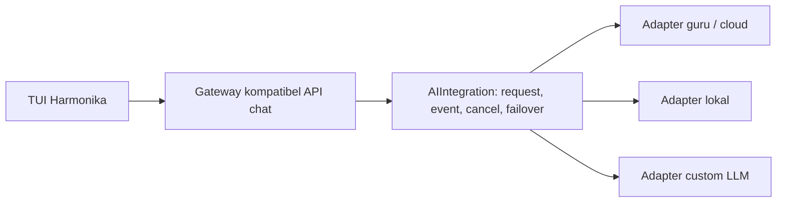

# Interface inference Harmonika Ai v1

Wrapper modular untuk mengganti engine tanpa mengubah kode TUI. Tersedia pada
rilis lokal `2026.10.24.14`; gateway sudah diaktifkan melalui restart terkontrol.
`harmonika network status` membedakan integration_contract_available dan
integration_contract_active. Implementasi
berada di `runtime/tools/ai_integration.py` dan factory `ai_adapters.py`.
Gateway hanya menerjemahkan kontrak TUI ke kontrak inference dan sebaliknya.



## Payload internal

```json
{
  "schema_version": 1,
  "messages": [
    {"role": "system", "content": "Jawab dengan tepat."},
    {"role": "user", "content": "Jelaskan struktur proyek ini."}
  ],
  "tools": [],
  "generation": {"max_tokens": 1024, "temperature": 0.2},
  "context": {"request_id": "req-001", "conversation_id": "session-001"}
}
```

Role, media content dan hubungan tool-call/result dipertahankan. Constructor
menyalin input agar perubahan pada dictionary asal tidak mengubah request.
`context` adalah metadata korelasi internal; tidak otomatis dikirim ke layanan.
Model, endpoint, headers dan key tidak diterima dari generation/context.

Tidak ada penyimpanan history baru. TUI tetap memasok riwayat sesi yang benar;
wrapper tidak menggabungkan pengguna atau mengubah guru menjadi training otomatis.

## Interface

```python
from runtime.tools.ai_integration import AIRequest
from runtime.tools.ai_adapters import build_integration

request = AIRequest.from_payload({
    "schema_version": 1,
    "messages": [{"role": "user", "content": "Halo"}],
    "generation": {"max_tokens": 128},
    "context": {"conversation_id": "session-001"},
})

# key_from_private_store disediakan aplikasi; jangan menulis key di source.
ai = build_integration(
    key=key_from_private_store,
    config={"primary_adapter": "teacher", "fallback_enabled": False},
)
result = ai.complete(request)  # AIResponse.text, reasoning, tool_calls, usage
for event in ai.stream(request):
    handle_event(event.type, event.data, event.sequence, event.request_id)
```

`AIAdapter` mendefinisikan `stream(request, cancellation)` dan
`complete(request, cancellation)`. Adapter memetakan payload/tokenizer/protokol
model sendiri dan mengembalikan `AIEvent` atau `AIResponse` tervalidasi.
`IntegrationError(code, retryable=False)` memberi error terstruktur tanpa raw
provider exception. Wrapper tidak menjalankan tool; hasil tool tetap melalui
executor/guard/approval aplikasi.

Event v1:

| type | data |
|---|---|
| `delta` | `text`, `reasoning`, dan/atau `tool_calls` |
| `usage` | `tokens` berisi statistik token yang tersedia |
| `completed` | `finish_reason` |

Wrapper memberi sequence mulai 1 dan request_id yang konsisten. Teks dan reasoning
terpisah. Terminal ditahan sampai iterator adapter selesai, sehingga custom
adapter yang menghasilkan data/error setelah terminal tidak mengirim sukses palsu.
Error/cancel memakai typed exception; gateway memetakannya ke error wire yang ada.

## Memilih adapter

Konfigurasi privat `~/.config/harmonika/tui-network.json`:

```json
{
  "port": 18184,
  "primary_adapter": "teacher",
  "fallback_adapter": "ollama",
  "fallback_enabled": true,
  "local_model": ""
}
```

- `teacher`: layanan Harmonika saat ini; struktur inference pihak ketiga tetap
  berada di adapter/layanan, bukan TUI.
- `ollama`: model lokal yang sudah terpasang; discovery dan capability gate tetap
  berlaku. Untuk menjadikannya utama, ubah primary_adapter, bukan kode TUI.
- `custom`: endpoint lokal kompatibel chat API; atur `custom_base_url`,
  `custom_model`, `custom_tools`, `custom_image_input`. Default capability false.
  Base URL harus HTTP loopback tanpa credential/query/fragment. Key guru tidak
  diteruskan. Model custom dengan protokol berbeda memakai subclass AIAdapter.

Perubahan konfigurasi diambil saat gateway dimulai kembali. Aktivasi dilakukan
melalui [prosedur maintenance](GATEWAY-MAINTENANCE.md); tidak ada model yang
diunduh atau writer sesi pengguna yang direstart.

## Model mandiri dengan protokol lain

Daftarkan factory lewat `AdapterRegistry.register(name, factory)`, lalu berikan
registry tersebut kepada build_integration. Misalnya factory `company` membuat
AIAdapter yang memanggil fungsi inference lokal sendiri; TUI dan payload tidak
perlu berubah. Pengujian menyertakan adapter tanpa HTTP untuk membuktikan alur ini.
Factory adalah kode tepercaya. Default key hanya diberikan ke factory teacher;
extension menerima key kosong. `credential_resolver(adapter_name)` dapat memberi
credential berbeda secara eksplisit dari penyimpanan privat per adapter.

## Batas dan verifikasi

- Failover maksimal satu kali sebelum output, termasuk reasoning/tool delta.
  Auth, entitlement/kuota dan error payload tidak menjadi pemicu failover.
- Cancellation kooperatif diteruskan ke adapter; penutupan consumer menutup
  iterator dan transport. Adapter custom wajib menerapkan deadline I/O sendiri.
- Request 2 MiB, output teks/reasoning masing-masing 200.000 karakter; event
  maksimal 128 KiB. Native response wire tetap identitas Harmonika Ai.
- Builtin local/custom memeriksa dukungan tools/media; tidak ada downgrade
  diam-diam. Kesiapan model lokal nyata masih harus diverifikasi terpisah.
- Tes swap guru/lokal/custom memakai request identik; fake custom LLM bekerja
  melalui gateway dan executable native tanpa mengubah TUI.
- Wrapper tidak melatih model atau merekam dataset guru. Pipeline training,
  persetujuan penggunaan data, evaluasi dan isolasi pengguna merupakan pekerjaan
  terpisah bila dibutuhkan nanti.

## Hasil verifikasi rilis

142 tes Python dan 56 tes Node.js lulus (198 tes TUI). Smoke wrapper teacher nyata
selesai sekitar 3,8 detik dengan satu terminal. Gateway/executable native juga
lulus dengan adapter fixture. Rilis lokal 2026.10.24.14 terverifikasi signature;
gateway sudah aktif pada kontrak v1 setelah verifikasi SSE dan native TUI nyata.
Lihat [laporan aktivasi](GATEWAY-ACTIVATION-REPORT.json).

Pedoman core mandiri dan jalur media Windows RTX: [filosofi arsitektur](ARCHITECTURE-PHILOSOPHY.md).

Audit mentor dan batas bukti tiap bridge: [kontrak mentor](MENTOR-CONTRACT-AUDIT.md).
