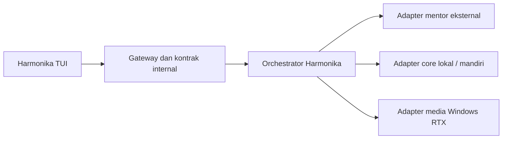

# Harmonika AI Architecture Philosophy

Pedoman desain untuk Harmonika TUI dan integrasi core Harmonika Ai.

## 1. Harmonika memiliki core; AI eksternal menjadi mentor

Codex, OpenCode, Google Mode bridge, dan WhatsApp AI bridge merupakan kemampuan
mentor yang dapat dipanggil melalui adapter internal sesuai kesiapan dan izin.
Kontrak domain, orchestration, penyimpanan sesi, identitas, guard, dan alur tool
milik Harmonika. Target jangka panjang adalah core mandiri yang dapat di-host
sendiri, dengan engine eksternal yang dapat diganti tanpa merombak aplikasi.

Mentor adalah peran arsitektur inference, bukan bukti model lokal otomatis belajar.
Perekaman dataset, evaluasi dan training memerlukan pipeline tersendiri, aturan
penggunaan data, serta isolasi pengguna. Jangan menggabungkan percakapan pelanggan
untuk training secara otomatis.

## 2. TUI hanya bergantung pada interface internal

TUI memakai payload dan event internal yang terversi. Detail SDK, engine/model,
credential, discovery endpoint dan protokol vendor berada pada adapter. Tampilan
layanan tetap Harmonika Ai. Engine baru harus melewati contract test yang sama.
Penggantian engine tidak mengubah komponen frontend, data sesi, atau executor tool.

Interface inference v1 saat ini: [AIRequest/AIIntegration/AIAdapter](AI-INTEGRATION.md).
Kontrak media perlu dikembangkan dan diberi versi sendiri jika hasil berupa
artifact/gambar; kontrak chat teks tidak boleh diklaim sudah mencakup semua output
media hanya karena menerima array content.

## 3. Windows RTX menjadi jalur utama pemrosesan gambar

Target arsitektur untuk mockup, vision dan pekerjaan gambar adalah worker pada
mesin Windows dengan GPU RTX melalui endpoint jaringan yang dikonfigurasi.
Frontend tidak mengetahui IP, credential maupun detail GPU. Adapter media menangani
serialisasi, transfer, readiness dan hasil, lalu mengembalikan kontrak Harmonika.

- Periksa konektivitas, kemampuan model dan kesiapan worker sebelum dispatch.
  GPU tersedia tidak membuktikan bahwa model vision/generasi sudah terpasang.
- Gunakan endpoint yang terdaftar dan terautentikasi. Di luar LAN, gunakan jalur
  privat/tunnel yang disetujui; jangan membuka API worker tanpa autentikasi.
- Tetapkan MIME dan ukuran input/output, checksum, request/job ID, deadline
  koneksi/proses, cancellation serta status error terstruktur. Jangan log isi
  gambar, prompt pelanggan, token, atau credential.
- Untuk job besar, kirim lewat kontrak upload/file atau multipart terukur;
  jangan menyisipkan blob tak terbatas pada history chat.
- Retry yang dapat membuat job baru harus memakai idempotency/job ID. Jika
  hasil request tidak diketahui setelah timeout, lakukan recovery status dahulu.
- Saat komputer mati, worker/model tidak siap, atau jaringan putus, laporkan
  unavailable/degraded. Fallback hanya ke adapter yang diizinkan dan mendukung
  tugas tersebut. Jangan mengarang analisis atau hasil gambar.
- Pisahkan resource/concurrency media dari chat agar render gambar tidak
  membekukan composer atau menghambat seluruh percakapan.

Komponen pertama adapter HTTP dan queue kini tersedia terpisah; generate RTX nyata
sudah diuji melalui tunnel privat. Vision/reference pada worker nyata belum
tersedia. Detail status: [pipeline RTX](../backend/rtx_queue/README.md). Endpoint,
readiness dan hasil visual harus diuji sebelum setiap capability dinyatakan siap.

## Kriteria perubahan

Setiap penambahan adapter harus membuktikan: payload sama, event dan error stabil,
credential terisolasi, sesi tidak tercampur, cancellation/resource cleanup bekerja,
dan TUI tetap kompatibel. Bedakan kemampuan yang sudah diuji, yang masih berupa
fixture, dan yang menunggu worker/model nyata.
